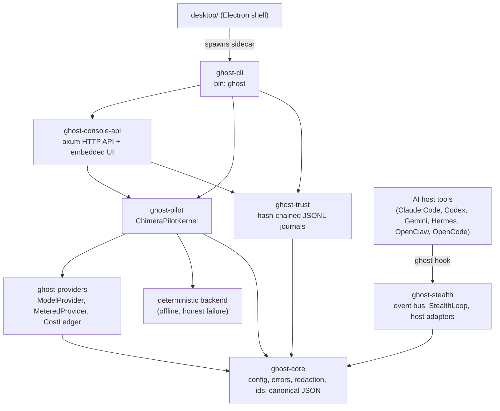

# GHOST-Chimera (Rust)

[](https://github.com/fernandogarzaaa/ghost-chimera-rs/actions/workflows/ci.yml)
[](LICENSE)

GHOST-Chimera rebuilt as a Rust workspace with a local-first CLI, console API,
provider adapters, trust journaling, and an Electron desktop shell. The rebuild
is under active development; a green unit-test job is not by itself a production
readiness claim. See [SPEC.md](SPEC.md) for the architecture and intended scope.

## Status

- **Workspace:** seven Rust crates (`ghost-core`, `ghost-trust`, `ghost-stealth`,
  `ghost-providers`, `ghost-pilot`, `ghost-console-api`, and `ghost-cli`).
- **Desktop:** Electron shell that launches the Rust `ghost` sidecar.
- **Verification:** CI runs formatting, Clippy, workspace tests, dependency
  policy checks, mutation testing, and desktop JavaScript syntax checks.
  Check the latest [CI run](https://github.com/fernandogarzaaa/ghost-chimera-rs/actions/workflows/ci.yml)
  for the current result rather than relying on a static test count.
- **Compatibility:** trust journals have cross-language fixtures in
  `crates/ghost-trust/tests/py_journal_compat.rs`.
- **Readiness boundary:** provider behavior, security controls, persistence
  recovery, and packaged installers still require the automated and manual
  verification described in [RELEASING.md](RELEASING.md) and
  [desktop/TESTING.md](desktop/TESTING.md). Open findings are tracked in
  [PHASE5_VERIFICATION.md](PHASE5_VERIFICATION.md).

## Architecture



## Crates

| Crate | Responsibility |
|---|---|
| `ghost-core` | Config, error types, secret redaction, stable ids, Python-compatible JSON |
| `ghost-trust` | `TrustRuntimeStore`: hash-chained JSONL run journals and replay |
| `ghost-stealth` | Event bus, StealthLoop, 6 host adapters (real `install()` payloads), `ghost-hook` binary |
| `ghost-providers` | `ModelProvider` trait, OpenAI-compatible and Anthropic clients, `MeteredProvider` + durable `CostLedger` |
| `ghost-pilot` | `ChimeraPilotKernel`: task compilation, backend selection, honest execution (deterministic offline backend) |
| `ghost-console-api` | axum HTTP API for the Ghost Console (status, conversation, trust, standing orders) with the UI embedded in the binary |
| `ghost-cli` | `ghost` command: `ask`, `trust replay`, `standing-orders`, `spend`, `console` |

## Build

```bash
cargo test --workspace
cargo clippy --workspace --all-targets -- -D warnings
cargo fmt --check
```

The workspace builds with rustls only (no OpenSSL / `pkg-config` needed).

## Usage

```bash
ghost ask "what is 2 + 2"              # journaled in the trust store
ghost trust replay <run-id>            # re-execute and compare outcomes
ghost standing-orders list|create|enable|disable|run
ghost spend show                       # per-provider calls, tokens, USD, budgets
ghost spend set-budget --provider openai --usd 5
ghost console --host 127.0.0.1 --port 8766
```

- **Providers** are enabled by their API-key environment variables (for
  example `OPENAI_API_KEY`, `ANTHROPIC_API_KEY`, `GROQ_API_KEY`). Without any,
  the kernel runs on the offline deterministic backend and reports honestly
  when it cannot fulfil an objective.
- **Spend metering:** every model call goes through `MeteredProvider`, which
  checks the budget *before* the request and journals calls, tokens and cost
  to `<state_dir>/cost_ledger.jsonl`. Prices come only from
  `GHOSTCHIMERA_<PROVIDER>_PRICE_IN_PER_1K` / `_PRICE_OUT_PER_1K` (USD per 1k
  tokens); when unset, cost is recorded as 0 and USD caps cannot trip, but
  calls and tokens are still journaled. If the ledger cannot be opened,
  providers are disabled rather than run unmetered.
- **Console security:** binding to a non-loopback address requires a bearer
  token (`--token` or `GHOST_CONSOLE_TOKEN`). Without a token the console is
  loopback-only and rejects requests whose `Host` or `Origin` is not loopback
  (DNS-rebinding and cross-site request protection).

## Key implementation notes

- **Hash-chain compatibility**: `ghost-core::canonical_json` is byte-identical
  to CPython's `json.dumps(sort_keys=True, separators=(",", ":"))`, including
  `ensure_ascii` escaping. Verified against CPython 3.12 test vectors.
- **`float_roundtrip`**: serde_json's default float parser is not correctly
  rounded, which silently breaks hash verification for timestamps. The
  workspace enables `float_roundtrip` — do not remove it.
- **No stub `install()`**: the `HostAdapter` trait has no default `install()`,
  so the OpenClaw stub (Python bug #1) is unrepresentable at compile time.
- **No fabricated success**: the StealthLoop records an intervention outcome
  only from real executor results; an empty action list is refused.

## Contributing and security

See [CONTRIBUTING.md](CONTRIBUTING.md) for the local checks CI enforces, and
[SECURITY.md](SECURITY.md) to report a vulnerability. Licensed under the
[MIT License](LICENSE).
